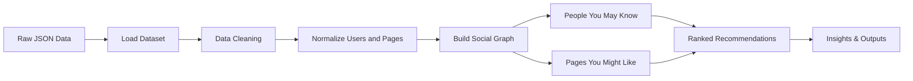
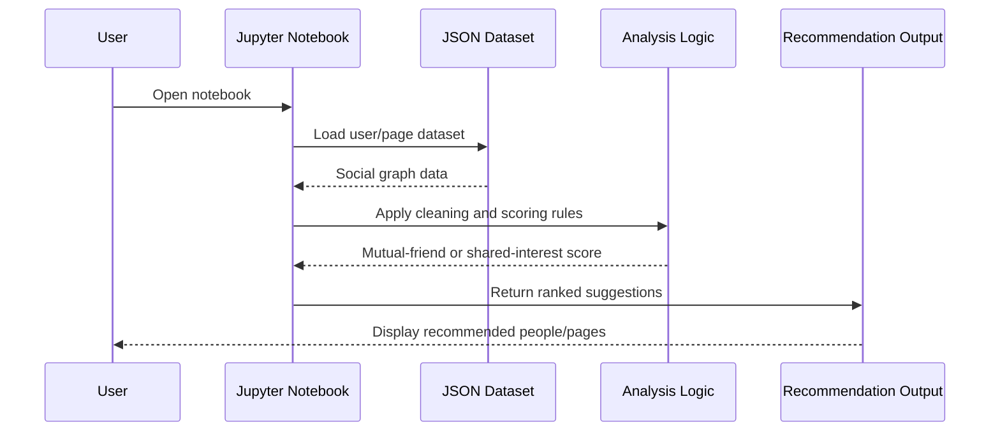

<div align="center">

# Big Data Analysis Project

</div>

<div align="center">
  
  
  
</div>

A data-driven social graph analysis project focused on building recommendation logic for users and content. The project explores how relationships between users, page interests, and mutual connections can be used to generate intelligent suggestions such as:

- People you may know
- Pages you might like
- Social-graph insights from community structures

This project is implemented as a series of interactive Jupyter notebooks and structured JSON datasets to keep the workflow easy to understand, reproducible, and extendable.

---

## Table of Contents

- [Project Overview](#project-overview)
- [Business Problem](#business-problem)
- [Objectives](#objectives)
- [Dataset Description](#dataset-description)
- [System Architecture](#system-architecture)
- [Workflow](#workflow)
- [Core Recommendation Logic](#core-recommendation-logic)
- [Project Structure](#project-structure)
- [How to Run](#how-to-run)
- [Notebook Walkthrough](#notebook-walkthrough)
- [Key Insights](#key-insights)
- [Future Enhancements](#future-enhancements)

---

## Project Overview

The idea behind this project is to model a small social network as a graph, where:

- Users are nodes
- Friendships are edges
- Liked pages are user preferences

By combining graph relationships with user interest data, we can derive meaningful recommendations. In practice, the project demonstrates how a platform could suggest new friends and content by examining mutual neighborhoods and shared affinity patterns.

### Why it matters

Recommendation engines power many digital experiences today, including:

- Social media friend suggestions
- Content discovery feeds
- Interest-based communities
- Marketplace or product discovery pipelines

This project is a simplified but effective prototype for that broader class of systems.

---

## Business Problem

In a connected community, users often know only a small subset of people around them. Platforms want to increase engagement by helping each user discover:

1. People they are likely to connect with
2. Pages or communities aligned with their interests

The challenge is to produce recommendations based on real relationship patterns rather than random suggestions. A graph-based approach is ideal because it leverages neighborhood similarity and shared interest overlap.

---

## Objectives

This project aims to:

- Explore a social network dataset using Python
- Clean and normalize raw user and page data
- Build recommendation logic using friends and liked pages
- Visualize relationships and user behavior patterns
- Learn how community-based analytics can drive personalization

---

## Dataset Description

The project uses JSON files that represent a social network dataset.

### Example Data Model

```json
{
  "users": [
    {"id": 1, "name": "Amit", "friends": [2, 3], "liked_pages": [101]},
    {"id": 2, "name": "Priya", "friends": [1, 4], "liked_pages": [102]}
  ],
  "pages": [
    {"id": 101, "name": "Python Developers"},
    {"id": 102, "name": "Data Science Enthusiasts"}
  ]
}
```

### Data characteristics

- Each user has a unique `id`
- A user can have multiple friends
- A user can follow or like multiple pages
- Pages are represented by their own `id` and name
- The dataset is structured for recommendation and graph analysis

### Data Files

- `data.json` — initial sample dataset
- `data_2.json` — secondary dataset for cleaning and transformation
- `massive_data.json` — larger dataset used for recommendation logic
- `cleaned_data_2.json` — cleaned output generated after preprocessing

---

## System Architecture



### Architecture summary

The pipeline is intentionally simple and modular:

- Data ingestion loads the social graph from JSON
- Cleaning removes invalid entries and duplicate records
- Graph construction maps users to friends and liked pages
- Recommendation modules compute suggestions
- Ranked outputs are returned as list-based recommendations

---

## Workflow



This workflow is simple but effective for learning how recommendation logic works in graph-based systems.

---

## Core Recommendation Logic

### 1) People You May Know

This recommendation pattern is based on the idea of mutual connections.

If User A is friends with User B, and User B is friends with User C, then C is a strong candidate to be recommended to A when:

- C is not already a friend of A
- C shares a high number of mutual friends with A
- The overlap is strong enough to imply relevance

#### Logic

```python
for friend in direct_friends:
    for mutual in user_friends[friend]:
        if mutual != user_id and mutual not in direct_friends:
            suggestions[mutual] = suggestions.get(mutual, 0) + 1
```

This counts how many shared links exist between a candidate user and the current user.

#### Example

```text
Amit -> friends: [2, 3]
Priya -> friends: [1, 4]
Rahul -> friends: [1]
```

Here, if User 1 is Amit and User 2 is Priya, then a strong candidate could emerge if they share multiple connections or overlap in network neighborhoods.

---

### 2) Pages You Might Like

This recommendation pattern relies on overlap between user interest profiles.

If a user likes pages A and B, and another user likes A, B, and C, then C becomes a likely recommendation because it is shared among similar users.

#### Logic

```python
for other_user, pages in user_pages.items():
    if other_user != user_id:
        shared_pages = user_liked_pages.intersection(pages)
        for page in pages:
            if page not in user_liked_pages:
                page_suggestion[page] = page_suggestion.get(page, 0) + len(shared_pages)
```

This acts like a collaborative filtering approach based on shared likes.

---

## Project Structure

```text
Big Data Analysis Project/
├── 01_introduction.ipynb
├── 02_data_cleaning.ipynb
├── 03_people_you_may_know.ipynb
├── 04_pages_you_might_like.ipynb
├── data.json
├── data_2.json
├── cleaned_data_2.json
├── massive_data.json
├── README.md
└── .ipynb_checkpoints/
```

---

## How to Run

### Requirements

- Python 3.10+
- Jupyter Notebook or JupyterLab
- Basic JSON and Python libraries

### Setup

```bash
cd "Big Data Analysis Project"
python -m pip install notebook jupyter
jupyter notebook
```

Then open the relevant notebook and run the cells in order.

### Example execution flow

1. Open `01_introduction.ipynb`
2. Load the dataset
3. Review user and page structures
4. Run `02_data_cleaning.ipynb` to sanitize the data
5. Run `03_people_you_may_know.ipynb` for friend recommendations
6. Run `04_pages_you_might_like.ipynb` for content recommendations

---

## Notebook Walkthrough

### 01_introduction.ipynb

Introduces the dataset and displays the user-page relationship structure. This notebook serves as the context-setting step and proves the graph relationship exists in the input data.

### 02_data_cleaning.ipynb

Focuses on preprocessing:

- Removing users with missing names
- Deduplicating friend lists
- Dropping inactive or empty users
- Removing repeated page entries
- Saving the cleaned dataset as `cleaned_data_2.json`

### 03_people_you_may_know.ipynb

Implements a mutual-friend recommendation algorithm and ranks suggested users by the number of shared connections.

### 04_pages_you_might_like.ipynb

Builds page suggestions based on user similarity and overlapping likes, producing a ranking of likely interesting pages.

---

## Key Insights

- Social graphs are naturally suited for recommendation problems
- Mutual connections are a strong signal in user-link prediction
- Shared interest patterns can effectively suggest relevant pages
- A small network can model larger recommendation logic in a simple way

### Visual insight

```text
User A  ── User B ── User C
   \       |
    \      |
      └── User D
```

User C and User D are likely relevant to User A because they are connected through a strong local neighborhood pattern.

---

## Future Enhancements

This project can be expanded significantly:

- Add visualization with NetworkX and matplotlib
- Build a real-time web dashboard
- Use weighted graph scoring for stronger recommendations
- Scale to millions of users with distributed processing
- Add collaborative filtering and matrix factorization techniques
- Compare graph-based recommendations with machine learning models

---

## Learning Outcomes

This project demonstrates core concepts in:

- Data cleaning and preprocessing
- Graph-based analysis
- Recommendation systems
- Social network analytics
- Data storytelling from structured JSON datasets

---

## Summary

This project is a practical introduction to graph-driven recommendation analysis in a social network context. By examining who users know and what they like, we can infer meaningful suggestions that resemble real-world personalization systems used by social platforms and digital communities.

It blends data analysis, recommendation logic, and graph thinking into a clear and accessible learning workflow.

---

## Note

This repository is designed as an educational and demonstrative social recommendation project. It focuses on clarity and understanding rather than production-scale infrastructure.
